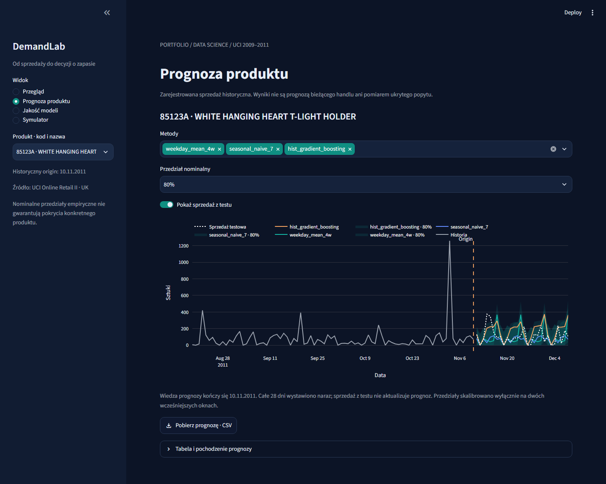
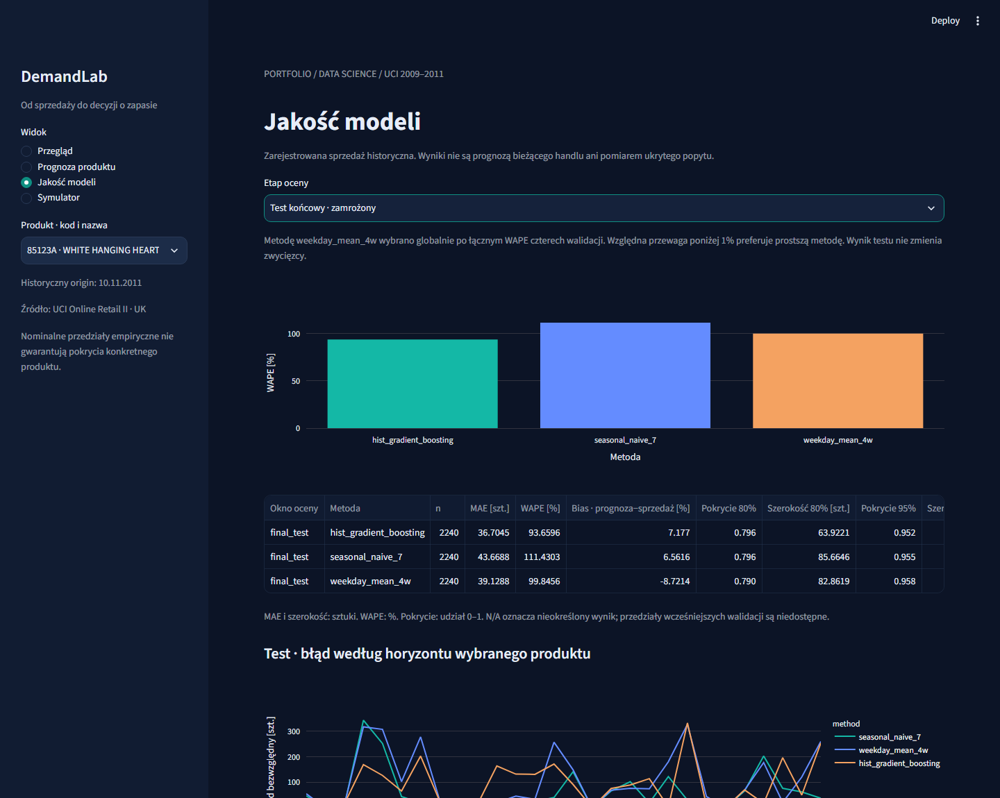
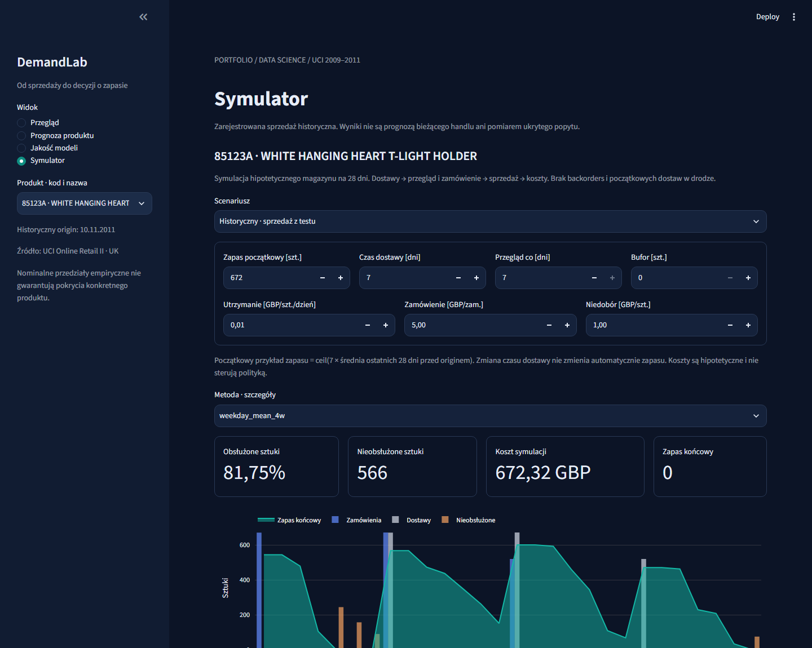
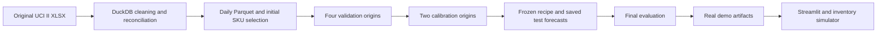

# DemandLab

A reproducible forecasting portfolio connecting **recorded sales** to a transparent hypothetical inventory policy. For recruiters and data science teams: original-source reconciliation, leakage controls, honest baselines and a usable Polish Streamlit demo.





## Run on Windows

```powershell
Set-Location C:\projekty\demandlab
powershell -ExecutionPolicy Bypass -File scripts\bootstrap.ps1
powershell -ExecutionPolicy Bypass -File scripts\run_app.ps1
```

Open http://localhost:8501. Demo uses committed real aggregates; it requires no UCI download or training. Package installation requires network.

If port 8501 is occupied, use `powershell -ExecutionPolicy Bypass -File scripts\run_app.ps1 -Port 8517` and open http://localhost:8517.

```powershell
powershell -ExecutionPolicy Bypass -File scripts\verify.ps1
powershell -ExecutionPolicy Bypass -File scripts\reproduce.ps1
# Optional local original workbook:
# powershell -ExecutionPolicy Bypass -File scripts\reproduce.ps1 -SourceFile C:\data\online_retail_II.xlsx
```

## Docker

```text
docker compose up --build
```

Same bundled demo at localhost:8501; source download and model fitting never run at startup.

## Actual results

| split | method | mae | wape | coverage80 | width80 | coverage95 | width95 |
| --- | --- | --- | --- | --- | --- | --- | --- |
| validation | hist_gradient_boosting | 32.760 | 123.365 | N/A | N/A | N/A | N/A |
| validation | seasonal_naive_7 | 36.694 | 138.180 | N/A | N/A | N/A | N/A |
| validation | weekday_mean_4w | 32.592 | 122.731 | N/A | N/A | N/A | N/A |
| final_test | hist_gradient_boosting | 36.705 | 93.660 | 0.796 | 63.922 | 0.952 | 242.280 |
| final_test | seasonal_naive_7 | 43.669 | 111.430 | 0.796 | 85.665 | 0.955 | 291.493 |
| final_test | weekday_mean_4w | 39.129 | 99.846 | 0.790 | 82.862 | 0.958 | 276.707 |

Default: **weekday_mean_4w**, selected on pooled validation WAPE before calibration and test. Coverage is a fraction; widths are recorded units.

The tree performed better on the original held-out test, but it does not replace
the validation winner. Browser inspection then found a mislabeled bias unit;
[the presentation correction](docs/post_test_correction.md) preserves original
test manifests and results. Repeated scoring is disclosed as a replay after test exposure.

## Architecture and decisions



Origins anchor every historical feature. Training labels must satisfy origin+28<=cutoff. Initial 365-day SKU selection avoids future survival bias. Signed calibration intervals are applied only after both calibration windows.

## Limits and evidence

Historical 2009–2011 data does not forecast current trading. Zero-filled dates assume source completeness; source contains no real stock, unmet demand or supply lead times. Large valid transactions are retained. Inventory costs and safety stock are hypothetical; finite-horizon truncation is explicit.

See [data contract](docs/data_contract.md), [methodology](docs/methodology.md), [results](docs/results.md), [model card](docs/model_card.md), [simulator](docs/inventory_simulator.md), [reproduction](docs/reproducibility.md), [case study](docs/portfolio_case_study.md), [demo script](docs/demo_script.md) and [execution evidence](PROJECT_STATE.md).

Own code: MIT. Derived UCI data: CC BY 4.0, Chen (2012), DOI [10.24432/C5CG6D](https://doi.org/10.24432/C5CG6D); see DATA_LICENSE.md. Raw invoices/customer IDs are not distributed.

## Po polsku

DemandLab porównuje prognozy zarejestrowanej sprzedaży i pokazuje ich działanie w hipotetycznej polityce zapasu. Cztery widoki aplikacji: przegląd, prognoza produktu, jakość modeli, symulator z eksportem. Wynik testu nie służy do wyboru metody.
