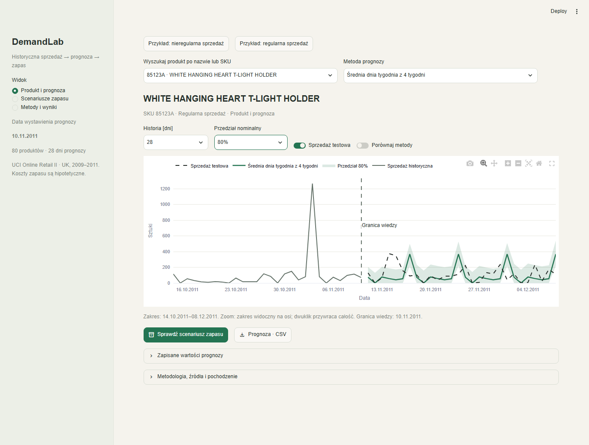

# DemandLab

A local analytical demo for exploring recorded retail sales forecasts, uncertainty
and inventory scenarios. It displays a completed, frozen study of 80 UK products;
changing controls never trains a model or downloads data. Forecasts were issued
on **10 November 2011** and evaluated through **8 December 2011**.



[Inventory scenarios](docs/screenshots/frontend_inventory.png) ·
[Methods and results](docs/screenshots/frontend_methods.png) ·
[Three-minute walkthrough](docs/demo_script.md)

## Get the complete application

The full current application is on
[`feat/demandlab-frontend-recruiter`](https://github.com/playson92/demandlab/tree/feat/demandlab-frontend-recruiter).
Use this branch; the original MVP has a separate review history.

With Git installed:

```sh
git clone --branch feat/demandlab-frontend-recruiter --single-branch https://github.com/playson92/demandlab.git
cd demandlab
```

Or [download this branch as a ZIP](https://github.com/playson92/demandlab/archive/refs/heads/feat/demandlab-frontend-recruiter.zip),
extract it completely, and open a terminal inside the extracted project folder.
The ZIP demo needs no Git. Folder names may contain spaces and Polish characters.

## Run with Docker

Install Docker Engine with Compose v2, or Docker Desktop, and start it. Internet
is required for the initial image build; the completed image runs offline.

```sh
docker compose up --build
```

Open **http://127.0.0.1:8501**. Stop this project's container with
`docker compose down` from the same folder. For a different host port, set
`DEMANDLAB_PORT` before starting Compose, for example:

```powershell
$env:DEMANDLAB_PORT = '8517'
docker compose up --build
```

On macOS/Linux use `DEMANDLAB_PORT=8517 docker compose up --build`. The published
port binds to loopback. The image contains only demo dependencies, bundled data
and the existing simulator.

## Run with Python

Requirements: **Python 3.12** and **uv** (the tested uv version is 0.13.0).
Install them using their official installers. Initial package installation needs
internet; subsequent starts use the local `.venv` and do not synchronize packages.

On Windows, the PowerShell 5.1 helper uses installed uv, or installs uv only
inside the project's `.venv` using the Python 3.12 `py` launcher:

```powershell
powershell -ExecutionPolicy Bypass -File scripts\bootstrap.ps1
powershell -ExecutionPolicy Bypass -File scripts\run_app.ps1 -Port 8501
```

On macOS/Linux, or Windows with uv already installed:

```sh
uv sync --frozen --python 3.12
python scripts/run_demo.py --port 8501
```

The last command selects the project's `.venv` automatically. If your system uses
`python3`, use `python3 scripts/run_demo.py`. No activation or global Python
configuration is needed. From another directory pass the absolute, quoted path
of `scripts/run_demo.py`. Open **http://127.0.0.1:8501**; stop with Ctrl+C.

[Setup and troubleshooting](docs/demo_setup.md) covers missing bundled files,
ports and dependency groups. URL parameters restore a view only while your
local app is running.

## Read the study and the code

The default method, the four-week weekday mean, was chosen on validation. Its
final WAPE is **99.85%**, versus **93.66%** for the tree model; WAPE is an error,
and lower is better. The final test did not change the selected method. Large
errors and difficult products remain visible. Sales records are not unconstrained
demand; stockouts and missing demand cannot be inferred from these transactions.
Inventory costs are hypothetical GBP assumptions, not measured business savings.

[Published results](docs/results.md) · [Methodology](docs/methodology.md) ·
[Research reproduction](docs/reproducibility.md) ·
[Presentation correction disclosure](docs/post_test_correction.md) ·
[Frontend structure](docs/frontend.md)

`app/` contains presentation, state and charts; `src/demandlab/` contains the
unchanged calculation engine; `data/demo/` contains the offline dataset;
`reports/` retains the published study. Frontend and historical study versions
are distinct. Do not rerun the frozen final test from this frontend branch.

Developer checks use the same lockfile:

```sh
uv sync --frozen --extra research --extra dev --python 3.12
uv run --no-sync python scripts/protect_study.py check --manifest docs/study_integrity.json
uv run --no-sync ruff check .
uv run --no-sync ruff format --check .
uv run --no-sync pytest
```

CI runs fixture regressions and browser startup on Windows, Linux and macOS,
plus container browser interaction. Job artifacts record actual OS/architecture;
only completed jobs are evidence of a tested platform. Scientific package
versions were preserved when separating demo, research and development extras.

On Windows, the public verification entry point runs integrity, Ruff and the full
fixture suite once (also used by Windows CI):

```powershell
powershell -NoProfile -ExecutionPolicy Bypass -File scripts\verify.ps1
```
AI assistance was used in implementation and review; the code and validation
evidence are available for inspection.

## Podsumowanie po polsku

DemandLab pozwala wybrać produkt, obejrzeć prognozę z przedziałem niepewności,
porównać scenariusze zapasu A/B i sprawdzić wyniki metod. Demo korzysta z
historycznych, zamrożonych danych; koszty są hipotetyczne. Pobierz wskazaną gałąź
lub ZIP i uruchom Docker albo Python 3.12 z uv. Po pierwszej instalacji demo
działa lokalnie bez internetu i bez ponownego treningu.
